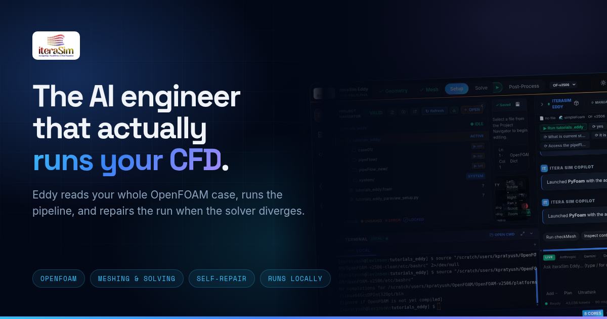
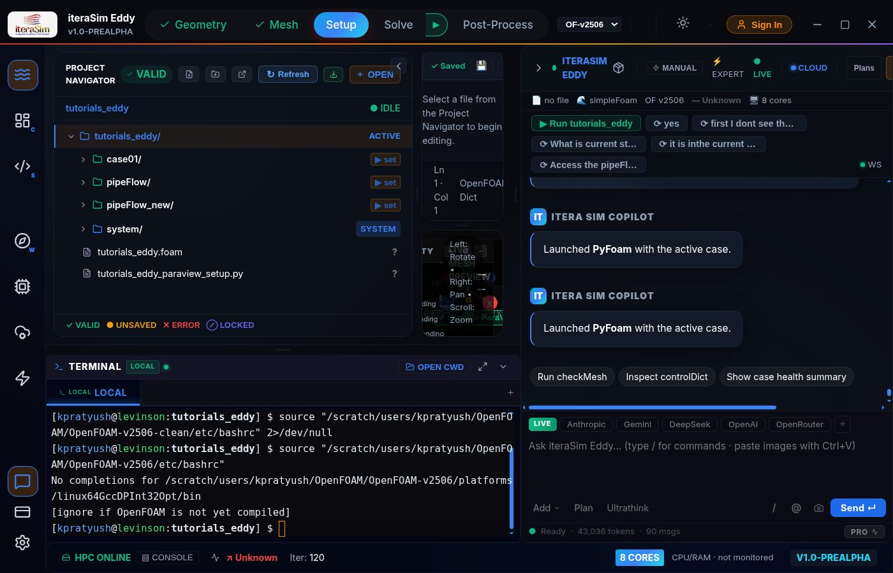
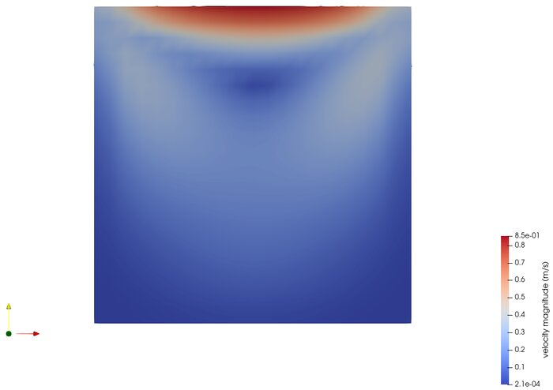

<div align="center">



# iteraSim Eddy

**An AI agent that sets up, runs and repairs OpenFOAM CFD simulations.**

[](https://github.com/iterasim/eddy-releases/releases/latest)
[](https://github.com/iterasim/eddy-releases/releases)
[](#download)
[](https://www.iterasim.in/eddy.html)

[**Download**](#download) · [Documentation](https://docs.iterasim.in/) · [Discussions](https://github.com/iterasim/eddy-community/discussions) · [Website](https://www.iterasim.in/eddy.html)

</div>

---

Eddy reads your entire OpenFOAM case — geometry, mesh, boundary conditions,
solver logs — then builds it, meshes it and runs it. When the solver diverges,
it diagnoses the numerical cause, patches the dictionary and re-runs.
Unattended.

It runs on your machine. Your geometry never leaves your network.

<div align="center">

</div>

## Download

Latest builds are on the [**Releases**](https://github.com/iterasim/eddy-releases/releases/latest) page.

| Platform | File | Install |
|---|---|---|
| **Linux** | `iteraSim-Eddy-<version>.AppImage` | `chmod +x` it and run it. No root, no dependencies. |
| **Windows** | `iteraSim-Eddy-Setup-<version>.exe` | Run the installer. The backend runs in WSL2. |
| **macOS** | — | Not yet — on the roadmap. |

```bash
# Linux
chmod +x iteraSim-Eddy-1.0.0.AppImage
./iteraSim-Eddy-1.0.0.AppImage
```

Verify what you downloaded against the checksum on the release page:

```bash
sha256sum iteraSim-Eddy-1.0.0.AppImage
```

### Requirements

- 64-bit Linux or Windows, 8 GB RAM or more
- **OpenFOAM v2306 or newer**, installed separately — Eddy is the interface,
  OpenFOAM is the engine. Eddy detects it at launch and shows the version it
  picked in the status bar.
- ParaView and FreeCAD are optional; Eddy can install them for you.

The ESI-OpenCFD fork is fully supported. The Foundation fork (v9–v11) works for
most cases. foam-extend is not supported.

## What it does

| | |
|---|---|
| **Case Builder** | Nine solvers with complete templates — physics, per-patch boundary conditions, fvSchemes/fvSolution presets, runtime control. No hand-editing dictionaries. |
| **Meshing** | blockMesh, snappyHexMesh and Gmsh, with STL/STEP import, a live 3D preview, and checkMesh parsed into plain English. |
| **Run & self-repair** | Live residuals, one-checkbox parallel runs via decomposePar and mpirun, and crash diagnosis that patches the case and restarts it. |
| **HPC** | Submit to Slurm or LSF over SSH, stream the remote log back, rsync results home. Inherits your `~/.ssh/config`. |
| **Copilot** | Chat grounded in the open case — it answers with your values, not generic advice. |
| **Surrogates** | Train FNO, DeepONet or PINN models on runs you've already completed. |

## Verified against known physics

Eddy is checked against benchmarks whose answers are already in the literature.
The lid-driven cavity at Re = 1000 reproduces Ghia, Ghia & Shin (1982) along the
vertical centreline to well under one percent, with the primary vortex near
(0.53, 0.56).

<div align="center">

</div>

## Pricing

The desktop app and the whole local OpenFOAM workflow are **free forever**.
Paid tiers cover managed AI routing and the curated OpenFOAM knowledge base —
see [iterasim.in](https://www.iterasim.in/eddy.html#pricing).

## Support

- **Questions, bugs, feature requests:** [Discussions](https://github.com/iterasim/eddy-community/discussions)
- **Documentation:** [docs.iterasim.in](https://docs.iterasim.in/)
- **Email:** info@iterasim.in

When reporting a bug, include your distribution and version, your OpenFOAM
version (status bar, bottom right), the Eddy version (Help → About), and the
steps to reproduce.

---

This repository holds **release artifacts only**; the application source is private.
Eddy is in pre-alpha — features labelled *Roadmap* on the website are not built yet.

<div align="center">

Built in Zürich by [iteraSim](https://www.iterasim.in/) · *Navigating Possibilities in Fluid Dynamics*

</div>

<sub>OPENFOAM® is a registered trade mark of OpenCFD Limited, producer and distributor of the OpenFOAM software via www.openfoam.com. iteraSim is not approved or endorsed by OpenCFD Limited. ParaView is a trademark of Kitware, Inc.</sub>
